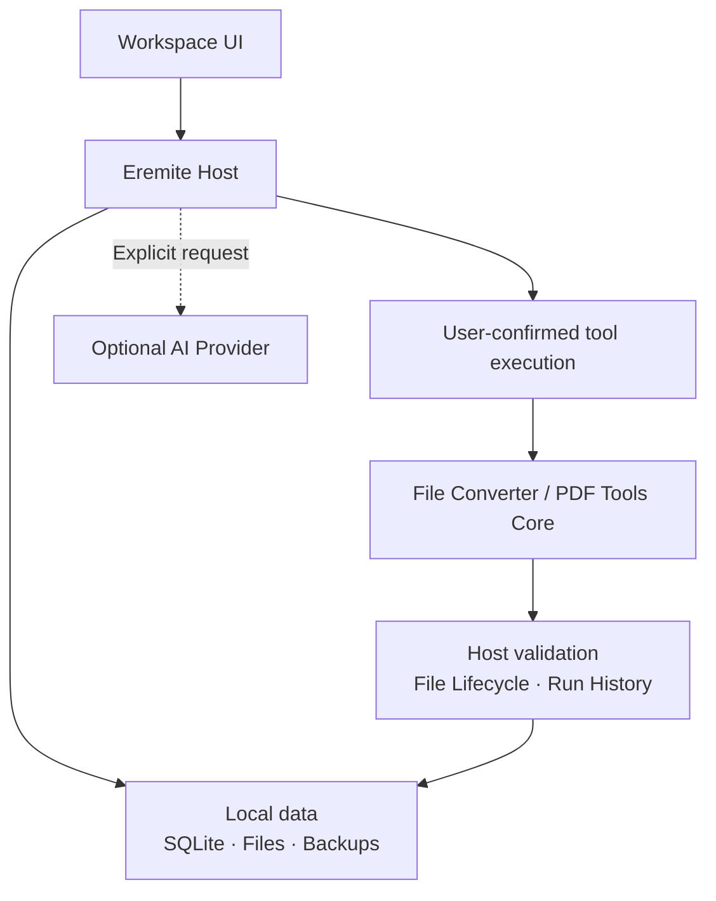

<div align="center">

# Eremite

**把资料、知识与下一步行动，放在同一个本地工作台。**

*A local-first workspace for files, knowledge, and action.*

[](https://github.com/W-SING-HUNG/Eremite/releases/latest)
[](https://github.com/W-SING-HUNG/Eremite/actions/workflows/ci.yml?query=branch%3Amain+event%3Apush)
[](LICENSE)
[](#运行环境)

[功能概览](#功能概览) · [快速开始](#快速开始) · [设计原则](#设计原则) · [文档](#文档与资源) · [v1.7.0 发行说明](https://github.com/W-SING-HUNG/Eremite/releases/tag/v1.7.0)

</div>

## 概览

Eremite 是一款面向个人的 **local-first 数字资料与行动管理应用**。它把文件、网页链接、项目、标签和待办行动连接起来，让收集、整理、阅读、处理和回顾发生在同一个工作空间。

**资料由你在本机保管，文件操作由你发起，AI 按需启用。** 从收集到行动，保留清晰的来源与历史。

> **收集内容 → 组织上下文 → 阅读与检索 → 转换文件或规划行动 → 保留历史**

## 功能概览

- **收集与整理**：保存文件和链接；通过 Projects、Folders 与 Tags 建立结构；集中处理待整理资料，通过回收站恢复已移入其中的对象。
- **搜索与阅读**：检索资料、行动、项目、文件夹及工具运行记录；在内置 Viewer 中查看 PDF、图片、TXT、Markdown、DOCX、ZIP 目录及浏览器支持的视频。
- **行动管理**：创建和管理 Actions，设置优先级、到期日与状态，并关联来源资料。
- **本地文件处理**：通过 File Converter 执行 18 条受控转换；使用 PDF Tools 合并、拆分、提取、旋转和重排页面。
- **可选 AI 辅助**：在 Ask Eremite 中基于获准读取的上下文提问，提出待确认的行动草稿、行动更新或文件工具运行建议。

单文件上传上限为 **512 MiB**。DOCX 预览为近似排版，ZIP 只展示目录、不解压；TXT 与 Markdown 支持显式编辑，保存时创建新文件版本。

### 为日常使用而设计

- **本地优先**：SQLite、原始文件和备份保存在本机；不依赖托管服务。
- **保留可追溯性**：文本编辑保存为新版本，转换生成新资料；符合重试条件的失败文件工具运行可创建新运行，保留原运行与来源版本。
- **明确操作边界**：Host（应用主程序）负责授权、文件校验、隔离执行与最终保存，工具 Core 提供文件处理能力。
- **可选而非强制的 AI**：不配置 Provider 也能正常使用资料管理、行动管理和本地文件工具。
- **中文友好的界面**：Emerald Pulse 视觉系统采用本地字体、清晰的阅读层次，并支持减少动画效果。

## 快速开始

### 运行环境

| 项目 | 要求 |
| --- | --- |
| 操作系统 | **Windows x64** |
| Node.js | **>=24.15.0 <25**，推荐 `24.15.0` |
| 安装方式 | **从源码运行**，需要 Git 和 npm |

当前 **v1.7.0** 为源码发行版，无 Windows 安装程序、公开托管实例或已发布的 npm 软件包。其他操作系统与 Node.js 主版本尚未验证。

在 **PowerShell** 中运行以下命令，获取已发布的 `v1.7.0` 源码：

```powershell
git clone --depth 1 --branch v1.7.0 https://github.com/W-SING-HUNG/Eremite.git
cd Eremite
npm.cmd ci
npm.cmd run dev
```

随后访问 <http://127.0.0.1:3000>，首次启动时设置本地密码并登录。日常启动仍使用 `npm.cmd run dev`；需要更换端口时，使用 `npm.cmd run dev -- --port 3001`。

构建并以生产模式在本机运行时，先停止开发服务，再执行：

```powershell
npm.cmd run build
npm.cmd run start
```

开发和生产启动脚本均限制监听 `127.0.0.1`；**请勿通过公网监听、反向代理或端口转发暴露应用**。

## 文件转换与外部依赖

基础的资料管理和行动管理无需安装下列文件处理引擎。使用对应转换能力时，需准备其依赖：

| 能力 | 依赖与边界 |
| --- | --- |
| 图片格式转换 | PNG、JPEG、WebP、AVIF 之间的 12 条转换，由 Sharp 支持 |
| 文档格式转换 | Markdown ↔ HTML、Markdown → DOCX 需要 [Pandoc 3.1+](https://pandoc.org/installing.html) |
| Office → PDF | DOCX、XLSX、PPTX 转 PDF 需要 [LibreOffice 7.6+](https://www.libreoffice.org/download/download-libreoffice/) |
| PDF 页面操作 | 五项 PDF Tools 操作需要 [qpdf **12.4.0**](https://github.com/qpdf/qpdf/releases/tag/v12.4.0)（精确版本） |

Pandoc、LibreOffice 和 qpdf **不随项目捆绑**。按[工具运行环境说明](docs/tool-runtime.md)配置可执行文件路径或应用进程的 PATH；缺失引擎或版本不符时，对应能力不可用。

Host 固定使用 [File Converter Core](https://github.com/W-SING-HUNG/Eremite-File-Converter-Core) `1.1.3` 和 [PDF Tools Core](https://github.com/W-SING-HUNG/Eremite-PDF-Tools-Core) `1.0.0-rc5` 归档。PDF Core 仍为预发行版；File Converter 的公开源码版本仍为 `1.1.2`，与 Host 使用的归档分别管理。详见[发行与依赖边界](docs/public-baseline.md)。

## 设计原则

### 数据在本机，控制权属于用户

- 默认数据目录为项目下的 `data/`，也可通过 `EREMITE_DATA_DIR` 指定其他目录；真实数据和备份不应进入 Git。
- **默认数据保存在项目目录内；删除、更换源码目录或升级前，请先备份并确认数据已安全保留。**
- 文件版本与工具输出通过统一的文件生命周期管理保存；AI 生成的操作建议需经用户确认，并由 Host 重新校验后执行。
- AI Settings 支持 OpenAI-compatible Provider；应用内配置的 API Key 存储在 Windows Credential Manager（服务端环境变量配置见 [.env.example](.env.example)）。只有显式发起 AI 请求或连接测试，才会向配置的 Provider 发出请求；请求可能包含问题及获准读取的资料文字。启用前请了解服务商的数据政策。
- Eremite 为**单用户、本机使用**而设计，本地登录密码不构成面向互联网部署的安全模型。

**升级前请使用应用内备份功能，验证备份并另存一份。** 恢复前须停止应用；不要直接复制运行中的 SQLite 数据库作为有效备份。操作说明见[备份与恢复](docs/backup-and-restore.md)。

### 清晰的 Host / Core 边界



Host 负责策略、授权、执行协调、验证、运行历史与持久化；工具 Core 提供无界面的文件处理能力。业务模块通过公开服务交互，AI 经 Host 适配器读取获准的上下文。详细契约与模块划分见[架构文档](docs/architecture.md)。

## 开发与验证

```powershell
npm.cmd run typecheck
npm.cmd test
npm.cmd run verify
```

自动化测试应使用**独立的 `EREMITE_DATA_DIR` 和合成数据**，不得连接真实个人数据。部分集成测试需要指定版本的外部文件引擎；详细要求见[贡献指南](CONTRIBUTING.md)与[工具运行环境](docs/tool-runtime.md)。

## 文档与资源

| 资源 | 链接 |
| --- | --- |
| **v1.7.0 正式发行说明** | [Release Notes](docs/releases/v1.7.0.md) · [GitHub Release](https://github.com/W-SING-HUNG/Eremite/releases/tag/v1.7.0) |
| **支持范围与已知限制** | [Public State](docs/PUBLIC-STATE.md) |
| **系统架构** | [Architecture](docs/architecture.md) |
| **工具环境与依赖** | [Tool Runtime](docs/tool-runtime.md) · [Distribution Boundaries](docs/public-baseline.md) |
| **备份与恢复** | [Backup & Restore](docs/backup-and-restore.md) |
| **参与贡献 / 获取支持** | [Contributing](CONTRIBUTING.md) · [Support](SUPPORT.md) |
| **安全报告** | [Security Policy](SECURITY.md) · [私密漏洞报告](https://github.com/W-SING-HUNG/Eremite/security/advisories/new) |

已知限制见[正式发行说明](docs/releases/v1.7.0.md)：`source-map-js@1.2.1` 的 **HIGH** 安全公告仍未修复，Eremite 中的利用可达性尚未验证；真实外部 AI Provider 行为尚未完成验收，任意长路径下的 LibreOffice 默认运行环境仍有待验证。运行配置与缓解方式见[工具运行环境](docs/tool-runtime.md)。

## 许可证

Eremite Host 自有代码以 **[Apache License 2.0](LICENSE)** 发布。正式作者署名见 [NOTICE](NOTICE)，第三方依赖与独立工具 Core 的许可证及声明见 [THIRD-PARTY-NOTICES.md](THIRD-PARTY-NOTICES.md)。
